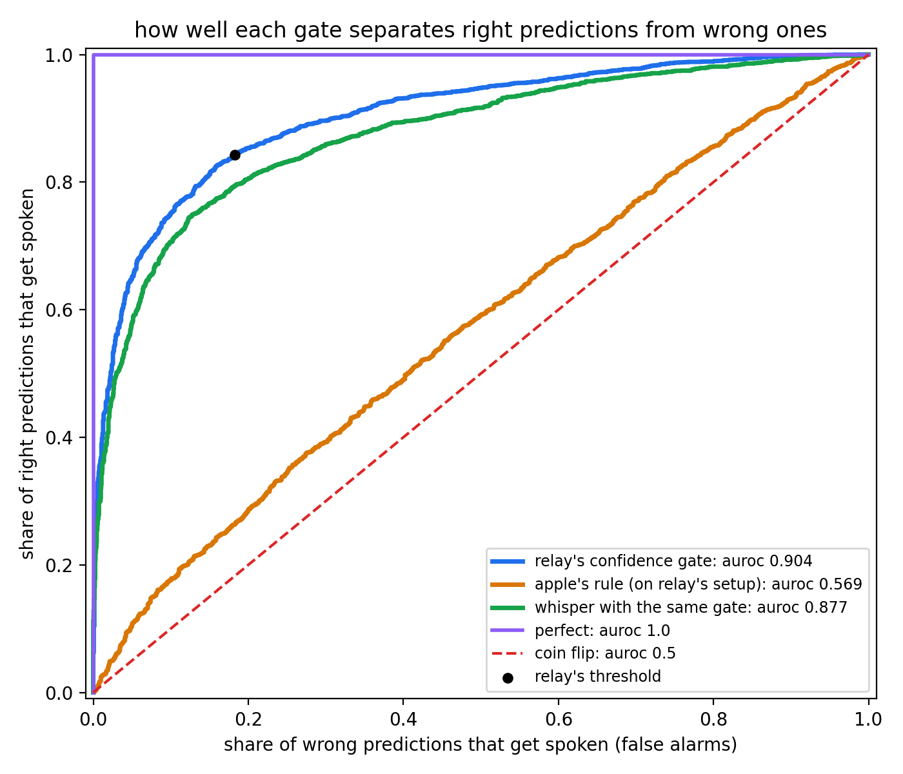

# relay: confidence-gated word recognition for dysarthric speech

**track:** ai + health

**team:** mofe atanda & bharath erusalagandi

## the problem

an estimated 97 million people worldwide can't rely on speech alone to be understood. dysarthria is one cause, and it affects about half of the 15 million people who have a stroke each year and most people with parkinson's disease. people with dysarthria know what they want to say, but their speech is hard to understand. we tested whisper, openai's widely used open-source speech-to-text model, on recordings of people with dysarthria, and it got the right phrase 52% of the time, and 21% for people with severe dysarthria. additionally, a model that says the wrong word for someone who can't correct it out loud is worse than one that stays quiet, and speech-to-text models like whisper speak every time.

## what we built

**who it's for:** we built relay for people who have difficulty speaking clearly because of conditions like als, a stroke or cerebral palsy. they can make sound, but the people around them often can't understand what they're saying.

**when they'd use it:** when they want to ask a caregiver or nurse for something, like water, and can't get the word across.

**how they use it:**
- **set up:** the user adds the words and phrases they want relay to recognize, including names and personal requests, and says each one three times. relay saves the recordings of each word.
- **use:** the user says a word or phrase. relay compares it from start to finish with each recording they saved and picks the closest one.
- **the confidence gate:** a small trained model then estimates how likely relay's prediction is to be right. if it is confident, relay says the word out loud in a clear voice. if it is less sure, it stays silent and shows the three closest saved words for the user to pick from.
- **learning from feedback:** relay learns each time the user confirms a word or corrects a wrong guess, so it gets better the more they use it.
- **caregiver view:**

## what we added

our own idea (not one of the suggested projects). relay builds on a 2023 apple paper that matched speech to a person's own saved recordings and chose between saying a phrase or nothing by looking *only* at how close the best match was. relay's confidence gate is a small trained model that looks at five clues to estimate how likely relay's prediction is to be right (e.g. how close the best match is and how loud the recording is).

## how it works

**data:** we used easycall, a public dataset of italian speakers saying 67 short commands for using a phone like "chiama emergenza" (call emergency). we removed 36 of its 21,386 recordings because they were too short to contain a full word (under 0.2 seconds) or longer than whisper can take in at once (over 30 seconds). we also fixed phrases that were spelled two different ways, so the same phrase wasn't counted as two. we tested on 27 speakers with dysarthria (16 mild, 6 moderate and 5 severe) and 24 speakers without it.

**saved and test recordings:** each speaker's first three recordings of each phrase are their saved recordings. relay and the baselines are tested on the same 5,149 later recordings from speakers with dysarthria. relay never saved any of them.

**how relay recognizes words:** for each test recording, relay and the whisper baseline both predict which of the 67 phrases was said. relay is built on whisper small, openai's speech-to-text model, without retraining it. relay uses its listening half to turn each recording into numbers, trims the silence, then compares the new recording to each saved one from start to finish (dynamic time warping). it chooses the phrase whose saved recordings are closest. this step works like a plug-in tool. it can sit on top of other speech models and requires no extra training.

**the confidence gate:** a small model (a logistic regression) that looks at five clues about each recording:

- how close the best match is
- how far behind the next closest saved word is
- whether the three saved recordings agree
- how long the recording is
- how loud the recording is

it combines the five clues into one confidence score from 0 to 1 and gives each clue its own weight. it sets these weights by learning how the clues differed when relay was right and when it was wrong on the practice speakers' recordings.

relay speaks only when that score is above a threshold. the threshold is also set on practice speakers and is chosen so that the wrong words above it are no more than 5% of their tries. when the score is below the threshold, relay stays silent and shows the three closest saved words for the user to pick from.

we split the 27 speakers into five groups, used four as practice and tested on the fifth, and rotated until every group was tested. this way the gate is never tested on someone it learned from.

**baselines:**
- **whisper small:** the same model relay uses, but with both its listening and writing halves. it chooses from the same 67 phrases as relay by scoring how likely each phrase is and choosing the most likely one. it has never heard the speaker's voice before, because it's a pretrained model.
- **simplest guess:** always says the most common phrase.

## results

all numbers are on the same 5,149 test recordings from the 27 speakers with dysarthria.

| | spoke | right word spoken or shown | wrong word spoken |
|---|---|---|---|
| simplest guess | 100% | 3.1% | 96.9% |
| whisper small | 100% | 52.4% | 47.6% |
| relay (no gate) | 100% | 72.4% (+20.0 vs whisper) | 27.6% (-20.0 vs whisper) |
| relay with the gate | 66.1% | **80.1%** (+27.7 vs whisper) | **5.0%** (-42.6 vs whisper) |

**with the confidence gate:**

| | right when spoken | showed three | right in the three | false alarms | missed |
|---|---|---|---|---|---|
| relay with the gate | 92.4% | 33.9% | 56.1% | 5.0% | 11.4% |

false alarms (relay speaks a wrong word) drop from 27.6% without the gate and land right at the 5% target even though the threshold was set on other speakers. missed cases are tries where relay showed three even though its prediction was right. on the tries where relay shows three, its best guess alone would be right only 33.6% of the time.

to check how well the confidence score separates right predictions from wrong ones, we used auroc. if you pick one try where relay was right and one where it was wrong, auroc is how often the gate gives the right one the higher score. relay's gate scores **0.904**, so about 9 times out of 10. putting the same gate on whisper scores 0.877. for whisper, the gate uses whisper's own scores (how likely its chosen phrase was and how far ahead it was of the next one) in place of relay's distances, plus the same length and loudness. apple's rule on relay's setup scores 0.569.

full results are in [results.md](results.md): by severity, speakers without dysarthria and men vs women.

**where it fails:**
- severe speakers get the most wrong spoken words (7.1%), above the 5% target.
- when someone says a word they never saved, the gate still speaks 16.9% of the time.
- phrases that differ by one sound (like "sali" and "mali") get mixed up.

this project is a prototype and is not medical advice.
