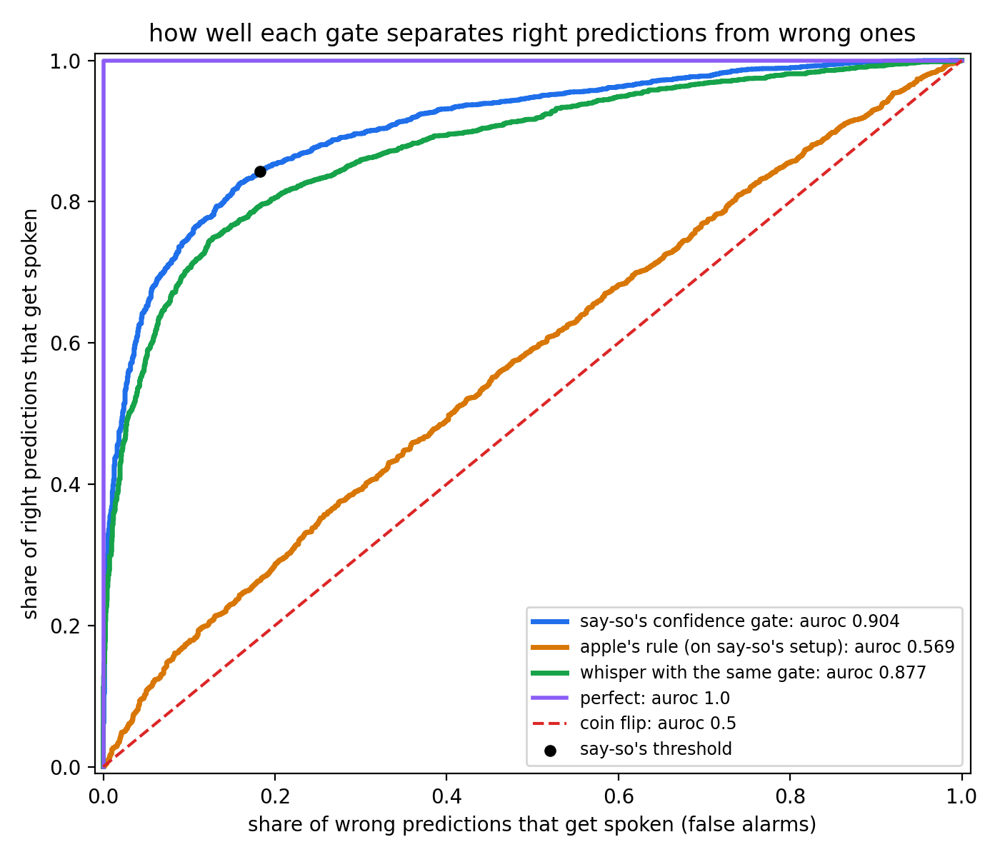
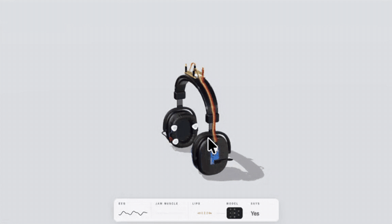

# say-so: confidence-gated word recognition for dysarthric speech

**track:** ai + health

**team:** mofe atanda & bharath erusalagandi

**code:** [say-so.ipynb](say-so.ipynb) ([open in colab](https://colab.research.google.com/github/mofe-stack/say-so/blob/main/say-so.ipynb))

## the problem

an estimated 97 million people worldwide can't rely on speech alone to be understood. one cause is dysarthria, which affects about half of the 15 million people who have a stroke each year and most people with parkinson's disease. people with dysarthria know what they want to say but are hard to understand. when we tested whisper (openai's widely used open-source speech-to-text model) on recordings of people with dysarthria, it got the right phrase 52% of the time and 21% for severe cases. a model that says the wrong word for someone who can't correct it out loud is worse than one that stays quiet, and speech-to-text models like whisper speak every time.

## what we built

say-so is a voice for people with dysarthria that learns their words from three recordings each and only speaks for them when it is sure.

**who it's for:** people who have difficulty speaking clearly because of conditions like als, a stroke or cerebral palsy. they use say-so when they want to ask a caregiver or nurse for something like water and can't get the word across.

**how they use it:**
- **set up:** the user says each word or phrase they want three times, including names and personal requests. say-so saves the recordings.
- **use:** the user says a word or phrase. say-so compares it from start to finish with each recording they saved and picks the closest one.
- **the confidence gate:** a small trained model then estimates how likely say-so's prediction is to be right. if it is confident, say-so says the word out loud in a clear voice. if it is less sure, it stays silent and shows the three closest saved words for the user to pick from.
- **learning from feedback:** say-so learns each time the user confirms a word or corrects a wrong guess, so it gets better the more they use it.

## what we added

our own idea (not one of the suggested projects). say-so builds on a 2023 apple paper that matched speech to a person's own saved recordings and chose between saying a phrase or nothing by looking *only* at how close the best match was. say-so's confidence gate is a small trained model that looks at five clues to estimate how likely say-so's prediction is to be right (e.g. how close the best match is and how loud the recording is).

## how it works

**data:** we used easycall, a public dataset of italian speakers saying 67 short phone commands like "chiama emergenza" (call emergency). we tested on the 27 speakers with dysarthria who had at least 4 recording sessions (16 mild, 6 moderate and 5 severe) and 24 speakers without dysarthria. we removed 36 of its 21,386 recordings that were too short or too long for whisper.

**saved and test recordings:** each speaker's first three recordings of each phrase are their saved recordings. say-so and the baselines are tested on the same 5,149 later recordings from speakers with dysarthria. say-so never saved any of them.

**how say-so recognizes words:** say-so and the whisper baseline both predict which of the 67 phrases was said. say-so uses the listening half of whisper small without retraining it to turn each recording into numbers. it trims the silence, compares the new recording to each saved one from start to finish (dynamic time warping) and chooses the phrase whose saved recordings are closest.

**the confidence gate:** a small model (a logistic regression) that looks at five clues about each recording:

- how close the best match is
- how far behind the next closest saved word is
- whether the three saved recordings agree
- how long the recording is
- how loud the recording is

it combines the five clues into one confidence score from 0 to 1 and gives each clue its own weight. it sets these weights by learning how the clues differed when say-so was right and when it was wrong on the practice speakers' recordings.

say-so speaks only when that score is above a threshold. the threshold is also set on practice speakers and is chosen so that the wrong words above it are no more than 5% of their tries.

we split the 27 speakers into five groups, used four as practice and tested on the fifth, and rotated until every group was tested. this way the gate is never tested on someone it learned from.

**baselines:**
- **whisper small:** the same model say-so uses, but with both its listening and writing halves. it chooses from the same 67 phrases as say-so by scoring how likely each phrase is and choosing the most likely one. it has never heard the speaker's voice before, because it's a pretrained model.
- **simplest guess:** always says the most common phrase.

## results

all numbers are on the same 5,149 test recordings from the 27 speakers with dysarthria.

| | spoke | right word spoken or shown | wrong word spoken |
|---|---|---|---|
| simplest guess | 100% | 3.1% | 96.9% |
| whisper small | 100% | 52.4% | 47.6% |
| say-so (no gate) | 100% | 72.4% (+20.0 vs whisper) | 27.6% (-20.0 vs whisper) |
| say-so with the gate | 66.1% | **80.1%** (+27.7 vs whisper) | **5.0%** (-42.6 vs whisper) |

**with the confidence gate:**

| | right when it spoke | showed three | right word among the three | false alarms | missed cases |
|---|---|---|---|---|---|
| say-so with the gate | 92.4% | 33.9% | 56.1% | 5.0% | 11.4% |

false alarms (say-so speaks a wrong word) drop from 27.6% without the gate to 5.0% and meet the 5% target even though the threshold was set on other speakers. missed cases are tries where say-so showed three even though its prediction was right. on the tries where say-so shows three, its best guess alone would be right only 33.5% of the time.

auroc measures how well the confidence score separates right predictions from wrong ones. if you pick one try where say-so was right and one where it was wrong, it is how often the gate gives the right one the higher score. say-so's gate scores **0.904** (about 9 times out of 10). the same gate on whisper scores 0.877 and apple's rule on say-so's setup scores 0.569.

full results are in [results.md](results.md): severity, speakers without dysarthria, men vs women, unsaved words, the keep learning feature and whisper's gate.

**where it fails:**
- severe speakers get the most wrong spoken words (7.1%), above the 5% target. we think this is because the threshold is set across all practice speakers and most of them are mild (16 of 27) while only 5 are severe.
- when someone says a word they never saved, say-so still speaks 33.3% of the time. the gate only learned from saved words so it never saw this case (see [words the user never saved](results.md#words-the-user-never-saved)).
- phrases that differ by one sound (like "sali" and "mali") get mixed up because the two recordings sound almost the same.

## what we'd do next

**a headset for muscle and brain signals:** we also tried boosted trees and a small neural network as the gate and they all landed around 0.90 auroc, so the limit seems to be the sound itself. a headset that picks up small muscle signals from the face and throat (emg) and brain signals (eeg) while the user speaks would add signals that come from the muscles and brain instead of the sound. say-so could compare these signals to the user's saved ones the same way it compares sound, and the gate could use them as extra clues.

*a 3d model of the headset.*

**english speech:** easycall is in italian, so the next step is testing say-so on english speakers with dysarthria. we couldn't do it this weekend because torgo, the open english dataset of dysarthric speech, doesn't have enough repeated recordings of the same words. only 39 words have 4 or more recordings across its 8 speakers with dysarthria.

**other speech models:** try a bigger whisper model (whisper large), hubert from meta and wavlm from microsoft in place of whisper small's listening half in order to see if they turn dysarthric speech into numbers that are easier to compare.

## sources

**data and models**
- easycall dataset (turrisi et al. 2021, cc by-nc 2.0): [paper](https://arxiv.org/abs/2104.02542) and [hugging face](https://huggingface.co/datasets/changelinglab/easycall-dysarthria)
- whisper small by openai: [paper](https://arxiv.org/abs/2212.04356) and [hugging face](https://huggingface.co/openai/whisper-small)
- whisper small for the browser demo: [onnx-community/whisper-small](https://huggingface.co/onnx-community/whisper-small)
- torgo dataset (english dysarthric speech): [university of toronto](https://www.cs.toronto.edu/~complingweb/data/TORGO/torgo.html)
- whisper large by openai: [hugging face](https://huggingface.co/openai/whisper-large-v3)
- hubert from meta: [hugging face](https://huggingface.co/facebook/hubert-large-ll60k)
- wavlm from microsoft: [hugging face](https://huggingface.co/microsoft/wavlm-large)

**other papers and facts**
- apple's latent phrase matching paper (2023): [arxiv](https://arxiv.org/abs/2306.05446)
- 97 million people who may benefit from other ways to communicate: [asha](https://www.asha.org/practice-portal/professional-issues/augmentative-and-alternative-communication/)
- dysarthria after a stroke and with parkinson's disease: [asha](https://www.asha.org/practice-portal/clinical-topics/dysarthria-in-adults/)
- 15 million people who have a stroke each year: [world health organization](https://www.emro.who.int/health-topics/stroke-cerebrovascular-accident/introduction.html)

**tools**
- [hugging face transformers](https://huggingface.co/docs/transformers) and [transformers.js](https://huggingface.co/docs/transformers.js)
- [onnx runtime web](https://onnxruntime.ai)
- [scikit-learn](https://scikit-learn.org), [librosa](https://librosa.org), numpy, pandas and matplotlib
- [google colab](https://colab.research.google.com)
- [claude code](https://www.anthropic.com/claude-code) (anthropic): an ai assistant that helped with code and the write-up

**this project is a prototype and is not medical advice.**
